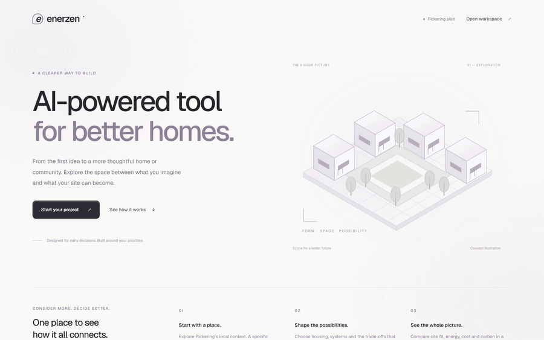
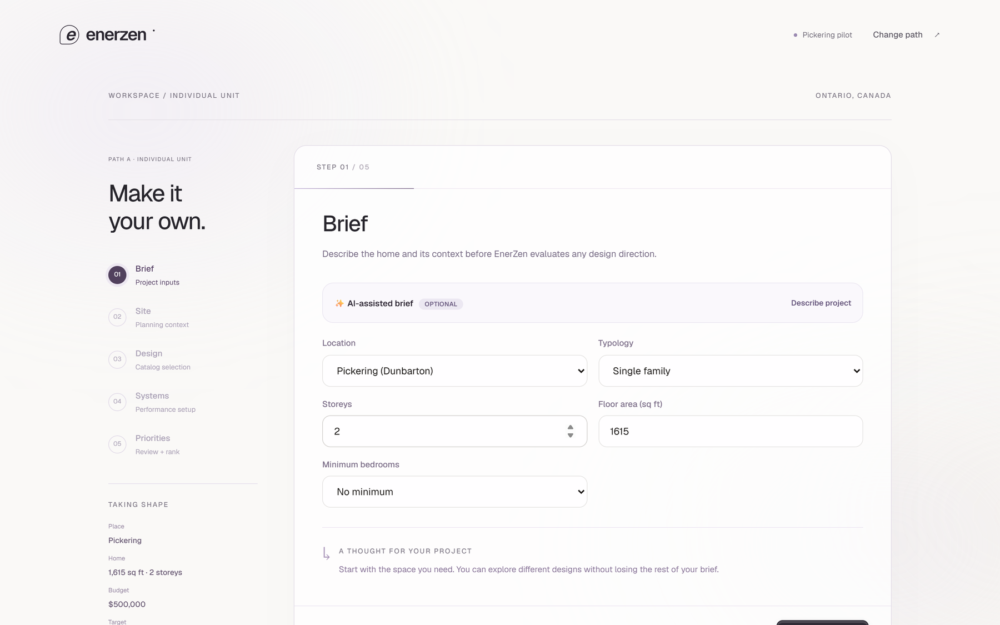
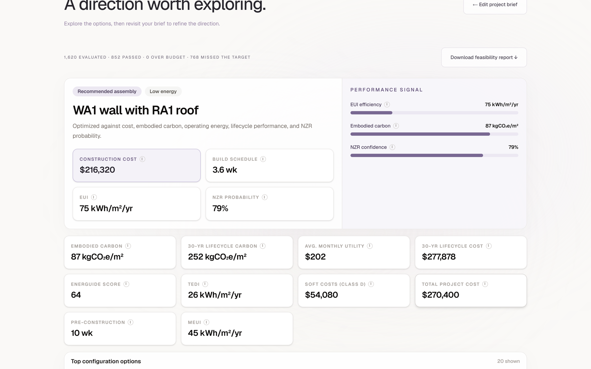
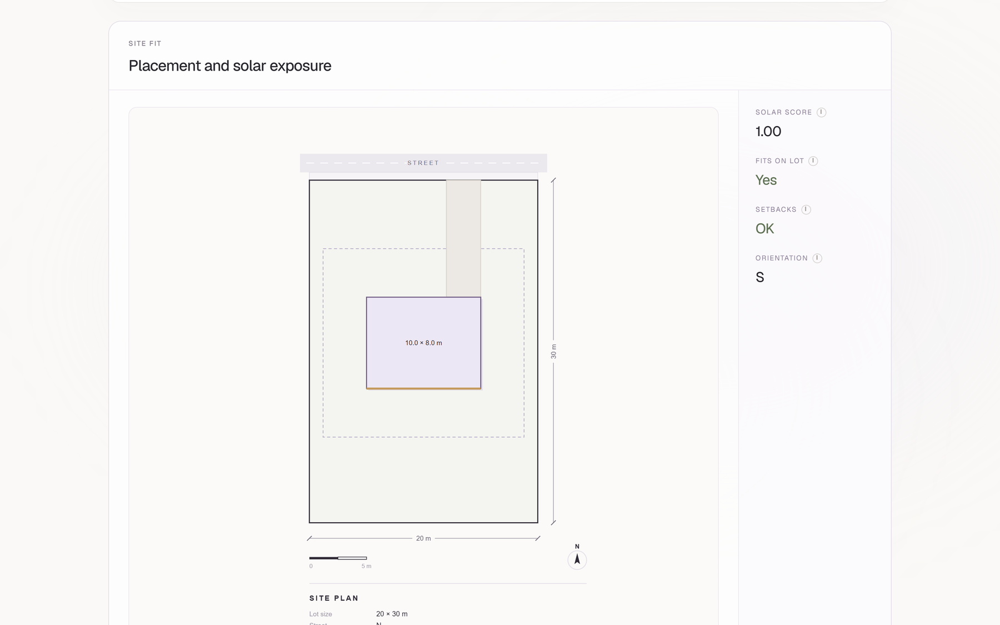
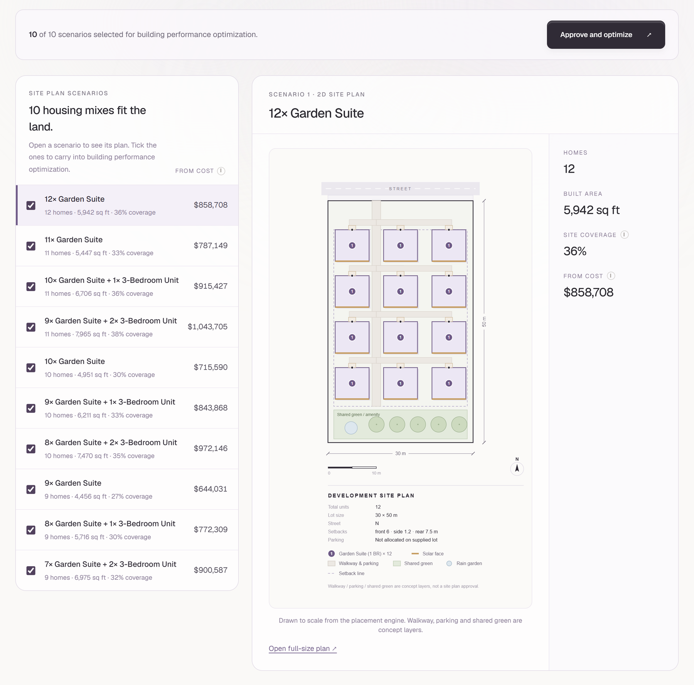

<div align="center">

# EnerZen Performance Engine

**From a lot and a brief to a buildable, costed, low-carbon home.**<br>
An optimization engine for EnerZen's prefabricated high-performance housing system.


[What it does](#what-it-does) · [Run locally](#run-locally) · [Home server](#run-on-a-home-server) · [Structure](#structure) · [Methodology](docs/METHODOLOGY.md)



<sub>One home, start to finish: the brief, the engine exploring 1,620 combinations, the recommendation and its site plan.</sub>

</div>

## What it does

Takes a building project's specifications and returns the best combination of wall panels, floor cassettes, and roof cassettes from EnerZen's assembly catalog — optimized across construction cost, build time, embodied carbon, and operational energy simultaneously. It also computes a passive-solar-optimized **site plan**: where the building and driveway sit on a given lot, respecting setbacks and maximizing solar gain for the fixed building orientation.

An OpenAI integration (`engine/ai.py`) lets users describe a project in plain language and get a pre-filled spec, and can generate an illustrative concept rendering of the site plan alongside the authoritative technical diagram.

<table>
<tr>
<td width="50%" valign="top">

**A brief in five short steps**

Location, site, design, systems and priorities, or describe the project in a sentence and let it fill them in.



</td>
<td width="50%" valign="top">

**One recommendation, with its numbers**

Construction cost, schedule, energy use, embodied and lifecycle carbon, and the chance of reaching Net Zero Ready.



</td>
</tr>
<tr>
<td width="50%" valign="top">

**A site plan drawn to scale**

The building and driveway placed inside the setbacks, turned for solar gain.



</td>
<td width="50%" valign="top">

**Whole communities, not just one home**

Every housing mix that fits the land, each with its own plan and starting cost, to approve before optimizing.



</td>
</tr>
</table>

## Run locally

**Backend (engine + API)**

```bash
pip install -r requirements.txt
cp .env.example .env   # add your OPENAI_KEY
uvicorn api.main:app --reload --port 8001
```

**Frontend**

```bash
cd web
npm install
npm run dev
```

Open http://localhost:3000. The frontend expects the API at `http://localhost:8001` (see `web/.env.local`).

**Legacy Streamlit UI** (kept temporarily as a reference during the migration to `api/` + `web/`; does not have the site-plan feature):

```bash
pip install -r ui/requirements.txt
streamlit run ui/app.py
```

## Run on a home server

`compose.yaml` runs the API and the web app in Docker, published on the server's Tailscale address only. Put `TAILSCALE_IP` and `OPENAI_KEY` in a `.env` beside it, then:

```bash
docker compose up -d --build
```

The web app is at `http://<TAILSCALE_IP>:3000` and the API at `http://<TAILSCALE_IP>:8001`. The web app is built against that API address, and the API allows it through `CORS_ORIGINS`.

### Pickering zoning map

`http://<TAILSCALE_IP>:3000/zoning` finds a Pickering lot by address, roll number or PIN, draws it on a Mapbox map with every zoning, Official Plan and overlay layer around it, and sets out the zoning review beside it:

1. **Property:** the City's parcel record: address, roll number, PIN, legal description, area.
2. **Zoning and Official Plan:** the zone and by-law, the Official Plan designation, and overlays on or near the lot (floodplain and TRCA regulation limit, natural and cultural heritage, easements, rail within 300 m, Greenbelt and Oak Ridges Moraine).
3. **Proposed development:** the lines of the by-law that state the zone's standards (frontage, yards, height, coverage, parking, units), each linked to its page, with a preliminary check of your numbers.
4. **Site:** servicing nearby, topography, and the zoning next door.
5. **Supporting documents:** what a complete application needs, plus the studies this lot's overlays trigger.
6. **Frameworks:** the by-law pages and excerpts for the zone, the council amendments that name the lot, and every stored by-law, plan and regulation.

A second tab searches the full text of every stored by-law. Put a public Mapbox token in `.env` as `MAPBOX_TOKEN` (the lot review works without one).

### Pickering zoning data

The server keeps its own copy of everything the map uses. To download or refresh it:

```bash
docker compose run --rm scrape-pickering
```

It collects:

- **City of Pickering ArcGIS:** every published layer (zoning, parcels, address points, Official Plan, overlays, servicing, topography and the rest), checked against the server's own feature counts.
- **Durham Region Official Plan, TRCA regulation limit and Ontario Greenbelt layers,** clipped to Pickering.
- **Comprehensive Zoning By-law 8149/24** (in force since 16 December 2024) and its schedules, the zoning and Official Plan pages, and every PDF on them. Scanned pages are read with OCR.
- **Every by-law on a council agenda since December 2024 that amends the zoning by-law,** from the City's eScribe meetings site.
- **The Provincial Planning Statement (2024) and O. Reg. 545/06.**

Everything goes into `./municipal-data/pickering` on the server (set `PICKERING_DATA_HOST_DIR` to move it). Each run writes a dated snapshot and switches over only when it got data, keeping the last two.

- `manifest.json` records the source, retrieval time and checksum of every file.
- `catalog.json` lists every layer published, downloaded or not.
- The manifest's `completeness` report names anything still missing: a layer short of the server's count, a by-law cited on the zoning map but not found, or an unreadable page. The zoning page shows the same gaps.

The run exits 0 only when nothing is missing. Re-check the stored copy any time with `--verify`. A weekly refresh from cron:

```cron
0 3 * * 1  cd /path/to/enerzen-prototype && docker compose run --rm scrape-pickering
```

Each zone's setbacks and lot standards are read from the by-law's tables, and each exception's from its section, into `zone_rules.json`. Every lot then gets its own setbacks, side by side:

1. the zone covering most of the lot
2. its table's values
3. its exception's changes
4. front toward the nearest road, and the exterior side yard toward a second street on a corner lot

Each value names its table or exception and page. A standard the by-law didn't yield is listed as missing, never filled with a default. The completeness report names any mapped zone without standards and any mapped exception without its section. To re-read the stored by-laws without re-downloading:

```bash
docker compose run --rm scrape-pickering python scripts/zone_rules.py --store /app/data/municipal/pickering
```

The API answers from that local copy only:

- `GET /locations/Pickering%20(Dunbarton)/zoning?latitude=…&longitude=…` (or `?query=<address, roll number or PIN>`): the six review steps for the lot.
- `GET /municipal/pickering/geocode?q=…`: parcels and addresses matching an address, roll number or PIN.
- `GET /municipal/pickering/map?latitude=…&longitude=…`: GeoJSON of the lot and every layer around it.
- `GET /municipal/pickering/search?q=…`: full-text search across every stored by-law page.
- `GET /municipal/pickering/documents` and `…/documents/file?path=…`: the stored documents.
- `GET /municipal/pickering/setbacks` and `…/setbacks.csv`: how many lots got every setback, and every lot's setbacks with their sources.
- `GET /municipal/pickering/status`: what is stored, when, and what is missing.

None of this is a zoning determination. Confirm with the City.

## Structure

```
engine/       # Core optimization + siting logic
  simulator.py    # Energy model (HOT2000-style degree-day)
  optimizer.py    # Multi-objective Pareto optimizer
  carbon.py       # Embodied + operational carbon
  cost.py         # Cost estimator + panel schedule
  materials.py    # Material table: R, cost, carbon per inch (one source of truth)
  rvalue.py       # Parallel-path effective R-value engine
  assemblies.py   # The 6 layer-defined parametric assemblies
  location.py     # Ontario location resolver (climate, snow, rates, soil)
  site.py         # Passive-solar site placement engine + SVG renderer
  ai.py           # OpenAI: freeform spec parsing, design rationale, concept renders
  report.py       # Per-project PDF report
data/
  assemblies.json # Windows, mechanical, solar, climate, rates, regions, snow
  ontario_locations.json # 227 Ontario locations (snow loads, regions)
api/
  main.py         # FastAPI service wrapping engine/ for the web frontend
web/              # Next.js frontend (form, results dashboard, site-plan viewer)
ui/
  app.py          # Legacy Streamlit interface (reference during migration)
docs/
  METHODOLOGY.md    # Full calculation methodology, incl. site-planning heuristics
  generate_pdf.py   # METHODOLOGY.md -> EnerZen_Methodology.pdf
tests/
  test_site.py    # Unit tests for the site placement engine
```
